

# 2D Mario

**A pirate-themed, Mario-style 2D platformer for desktop: world map, three levels, coins, stomping, particles and a full set of menus.**

Python · pygame · Tiled (CSV level layers) · single-player, offline

<table>
  <tr>
    <td>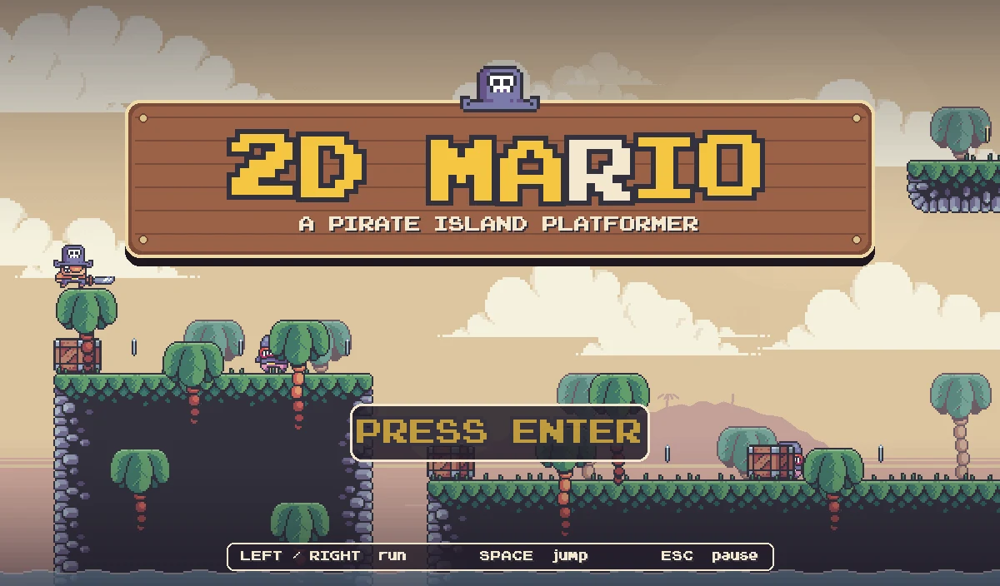</td>
    <td>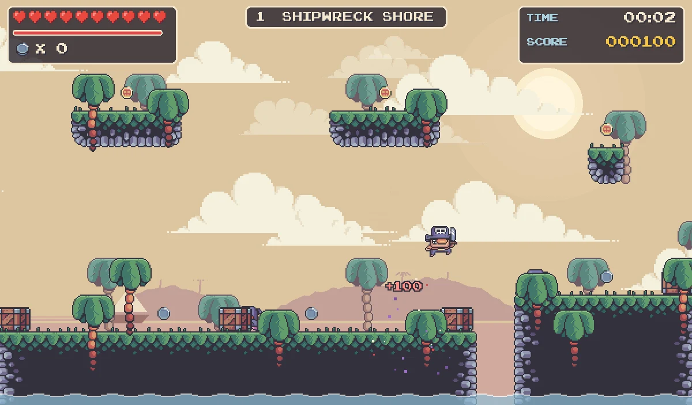</td>
    <td>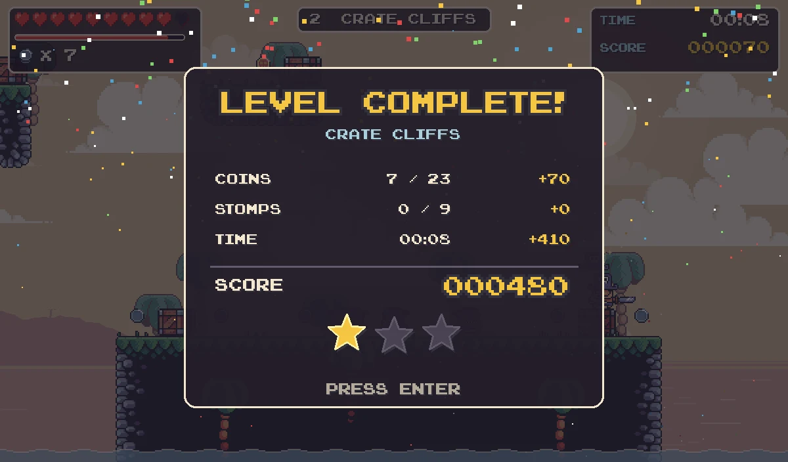</td>
  </tr>
</table>
Screenshots are real captures of a local build running on fictional demo data.

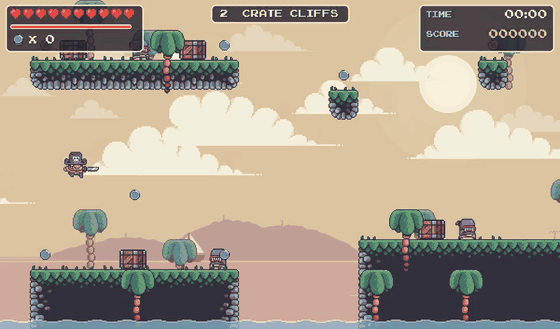

---

## Product at a Glance

| | |
|---|---|
| **What it is** | A single-player side-scrolling platformer with a world map |
| **Platform** | Desktop (Python and pygame); runs locally, no network |
| **Content** | 3 playable levels; map nodes 4 to 6 are locked placeholders |
| **Gameplay** | Run, jump, collect coins, stomp patrolling enemies, reach the goal flag |
| **Presentation** | Title screen, HUD, parallax backdrop, particles, pause menu, result and game-over screens |
| **Scoring** | Coins, stomps and a time bonus; 1 to 3 stars per level |
| **Levels** | Authored in Tiled, loaded from CSV layers through a data table |
| **Code size** | About 2k lines of Python |

## Product Showcase

<table>
  <tr>
    <td align="center">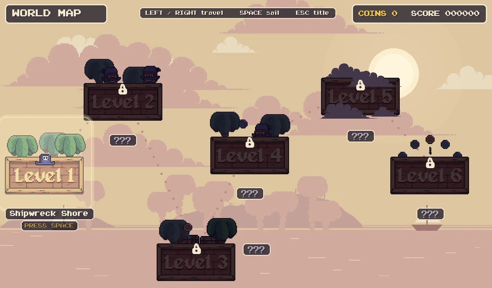 <b>World map</b> Locks and name tags</td>
    <td align="center">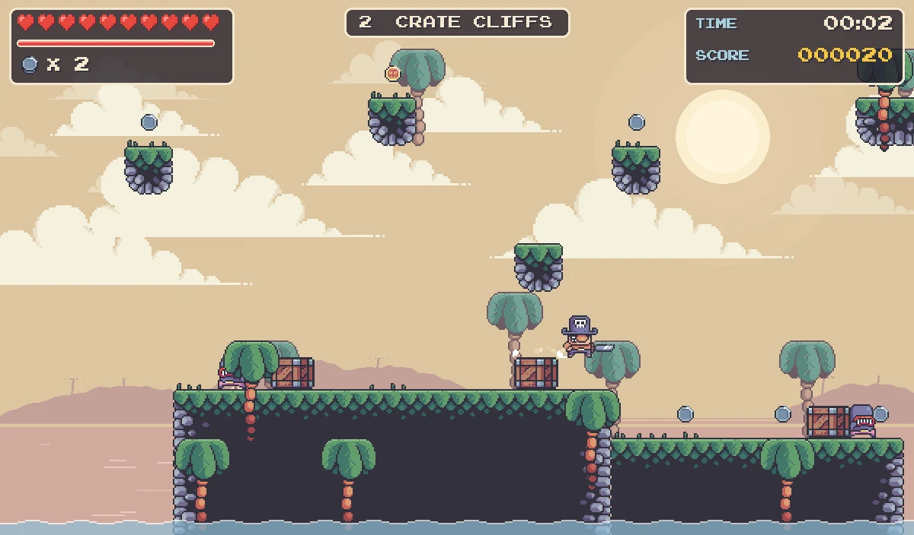 <b>Crate Cliffs</b> Floating platforms</td>
    <td align="center">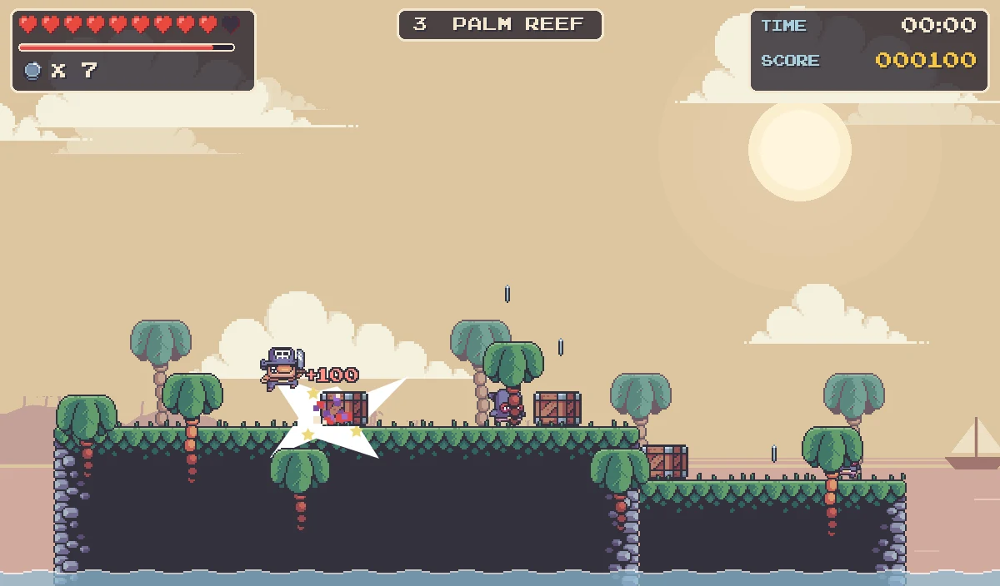 <b>Palm Reef</b> Enemy-defeat burst</td>
  </tr>
  <tr>
    <td align="center">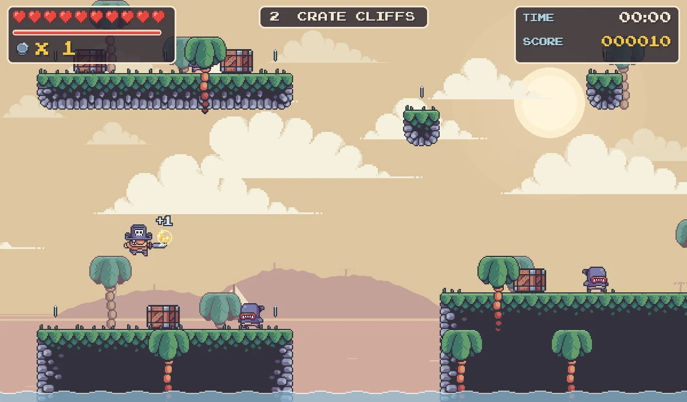 <b>HUD and coins</b> Sparkles, popup, counter</td>
    <td align="center">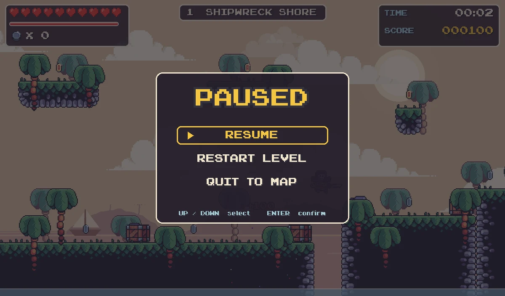 <b>Pause</b> Resume, restart, quit</td>
    <td align="center">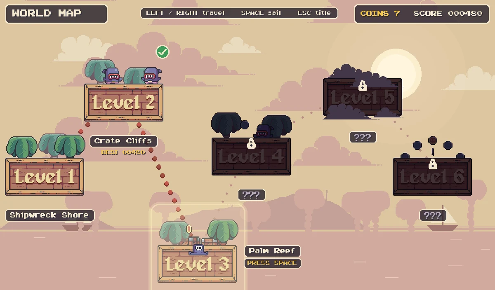 <b>Progress</b> Ticks and best score</td>
  </tr>
  <tr>
    <td align="center">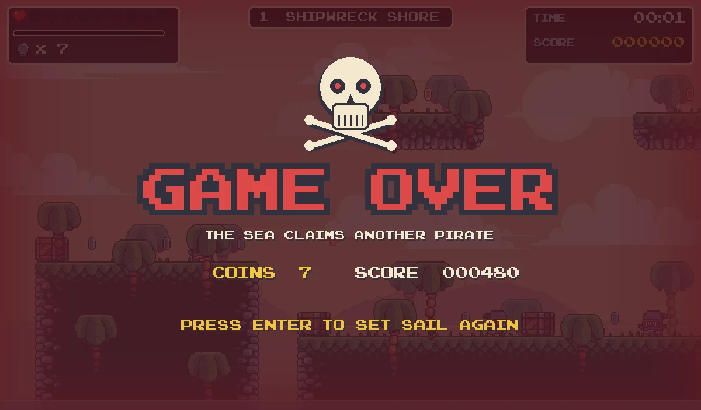 <b>Game over</b> Fresh run on Enter</td>
    <td></td>
    <td></td>
  </tr>
</table>

## Key Features

- **Platforming.** Run, jump and fall with an animation state machine; axis-by-axis collision against terrain, crates and foreground palms.
- **Enemies.** Rule-based patrols that reverse at constraint tiles; jump on them to defeat them, touch them from the side to lose 10 health.
- **HUD.** Ten hearts plus a smooth health bar, coin counter with icon, level name, timer and score.
- **Feedback.** Coin sparkles and popups, jump, land and run dust, enemy bursts, sea splash, screen shake and a red hit flash.
- **Camera and backdrop.** Eased follow camera with look-ahead; layered sky, hills, sea, boats and clouds scrolling at different rates.
- **Menus.** Title screen, pause (resume, restart, quit to map), level-complete card with stars and confetti, game-over screen.
- **World map.** Unlockable nodes, name tags, padlocks, completion ticks, best score and an animated route.
- **Audio.** Background music for the map and each level, plus jump, coin, stomp and hit effects.

## Architecture

A `Game` object runs a state machine (title, map, level, paused, complete, game over) and owns the run state. The map and levels are separate objects connected by callbacks. Levels load from Tiled CSV layers into pygame sprite groups through a data table; effects, HUD, screens and decoration live in their own modules.

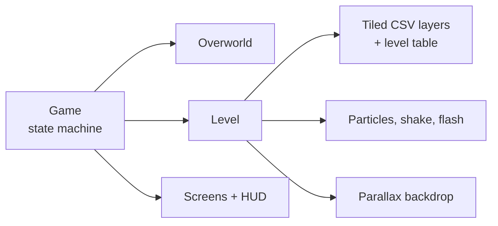

Details: [docs/ARCHITECTURE.md](docs/ARCHITECTURE.md).

## Engineering Highlights

- **Data-driven levels.** Adding a level means adding Tiled layers and one table entry.
- **Camera and collision.** The world scrolls by shifting sprites; the camera's per-frame shift is compensated so the player does not drift against the terrain.
- **Steady HUD under shake.** Shake and hit flash apply to the world render; the HUD draws afterwards.
- **One particle system.** Circles, squares, stars, rings and text popups share a world-anchored update and draw path.
- **All new UI is code-drawn.** Hearts, padlocks, ticks, stars, panels and the skull use pygame primitives, with no new asset files.
- **Headless capture.** The screenshots come from a scripted in-process run with dummy SDL drivers and a virtual clock.

More: [docs/ENGINEERING_CHALLENGES.md](docs/ENGINEERING_CHALLENGES.md).

## Status & Scope

- **Real:** the playable game, three levels, scoring, menus and effects shown above.
- **Rule-based:** enemy behaviour is scripted patrol. There is no AI or machine learning.
- **Placeholder:** map nodes 4 to 6 are locked and have no level.
- **Not included:** saves (progress lasts for the session), settings menu, online or multiplayer features, a web build.
- Runs locally on a desktop; it must be started from its code directory because assets load by relative path.

## Documentation

- [Product Overview](docs/PRODUCT_OVERVIEW.md)
- [Architecture](docs/ARCHITECTURE.md)
- [Technical Case Study](docs/TECHNICAL_CASE_STUDY.md)
- [Engineering Challenges](docs/ENGINEERING_CHALLENGES.md)
- [Privacy and Source](docs/PRIVACY_AND_SOURCE.md)

## Rights

Source is private and no licence is granted. See [RIGHTS.md](RIGHTS.md).
