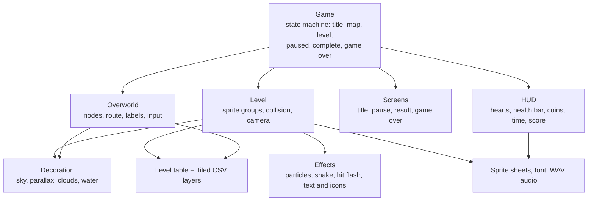

# Architecture

The diagram is original and conceptual. It describes responsibilities of the game's modules, not production source.

## 1. Modules

## 2. Game state

A single `Game` object owns the run: current health, coin total, highest unlocked level, completed levels and best results. It switches between six states and delegates each frame to the active one. Levels and the map notify it through callbacks (change coins, change health, level finished, level failed), so they do not know about each other.

## 3. Level pipeline

- Levels are authored in Tiled and exported as one CSV per layer (terrain, grass, crates, coins, foreground and background palms, enemies, enemy constraints, player and goal).
- A data-driven table maps each level to its CSV files, map position, unlock target and name.
- At load, a CSV loader turns each layer into a pygame sprite group: static tiles, animated coins, crates, palms and enemies.
- Enemy patrol is rule-based: enemies walk and reverse when they touch an invisible constraint tile.

## 4. Per-frame order of a level

1. Shift sprites by the camera delta from the previous frame.
2. Draw sky, parallax layers, clouds, background palms, terrain, enemies, crates, grass, coins and foreground palms.
3. Update the player, resolve horizontal then vertical collisions, then ease the camera.
4. Check death (fell into the sea), goal, coins and enemies.
5. Update and draw particles, then water, then screen shake and the hit flash.
6. The HUD is drawn afterwards by the game object so it stays steady during shake.

## 5. Presentation layer

Everything added in the polish pass is drawn in code with pygame primitives and the bundled pixel font: hearts, padlock, completion tick, skull, stars, panels, particles. No new asset files were introduced. Particles are world-anchored: they move with the level scroll.

## 6. Out of scope

Single-player only. No network, accounts, save files or AI. Enemy behaviour is scripted patrol.
